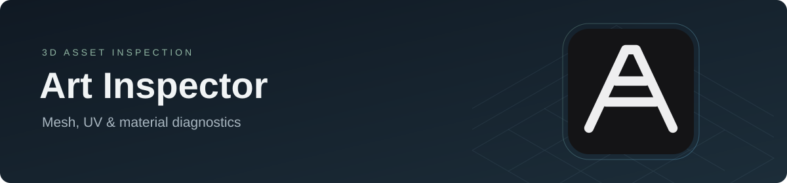

  

  
  
  

# Art Inspector

A portable Windows tool for checking 3D assets before they move through production.
Import an FBX or send meshes from Blender, then inspect geometry, UVs and materials.

## Features

- UV, texel density, face orientation, vertex color and shading checks.
- Z-Fighting Checker for overlapping and near-coincident surfaces.
- Collision display, Wireframe, Lit/Unlit modes and HDRI lighting.
- Seven editable HLSL materials and saved checker settings.
- [Blender Bridge](Blender/README.md) for sending selected meshes to the viewer.

## Quick start

1. Download **ArtInspector-v0.1.5-win64.zip** from [Releases](https://github.com/ArturPakkk/ArtInspector/releases).
2. Extract the complete **ArtInspector** folder.
3. Run **ArtInspector.exe** and import an FBX.

Requires **Windows x64** and a **Direct3D 11 / Shader Model 5.0** GPU.
Keep the extracted files together. For installation, use the release ZIP.

## Guides

[Settings & updating](docs/USAGE.md) ·
[Checker materials](Resources/Materials/README.md) ·
[Blender setup](Blender/README.md)

## License

Personal and commercial use is permitted under [LICENSE.md](LICENSE.md).
Redistribution and other rights are limited by those terms.
[Third-party licenses](licenses/THIRD_PARTY_NOTICES.md) apply separately.
[Licensing & provenance details](docs/licensing/ARTINSPECTOR_PROVENANCE.md).

Created by [ArturPakkk](https://github.com/ArturPakkk).
